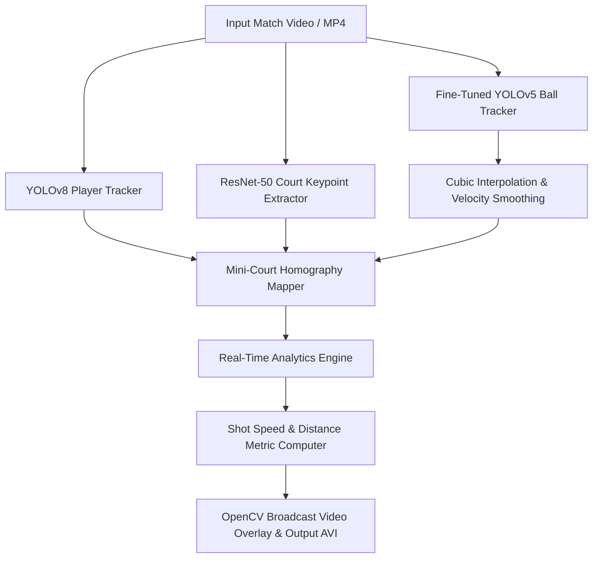

# 🎾 Autonomous Tennis AI Analytics & Vision Pipeline

[](https://www.python.org/)
[](https://pytorch.org/)
[](https://docs.ultralytics.com/)
[](https://opencv.org/)
[](LICENSE)

An end-to-end Computer Vision & AI Analytics system for professional tennis match analysis. This application detects players and tennis balls, projects 3D spatial coordinates onto a 2D synthetic court using neural network keypoints, and computes real-time athletic metrics including **shot speeds (km/h)**, **player movement velocity**, **live rally shot counters**, and **cumulative distance covered (meters)**.

---

## 📸 System Showcase


*Figure 1: Real-time broadcast overlay showcasing YOLO tracking, mini-court homography mapping, shot speed, player velocity, live rally counts, and total distance covered.*

---

## ✨ Key Capabilities & Features

- 🎯 **Object Detection & Tracking**: Leverages fine-tuned **YOLOv8** for player tracking and a custom-trained **YOLOv5** architecture optimized for high-speed tennis ball tracking.
- 📐 **Neural Court Keypoint Detection**: Custom **ResNet-50** deep learning pipeline to infer key court reference points from variable camera angles.
- 🗺️ **2D Homography & Spatial Mapping**: Maps pixel coordinates from broadcast camera angles onto a 2D synthetic mini-court using perspective transformations.
- 📊 **Real-Time Sports Analytics**:
  - **Live Shot Speed**: Computes ball velocity in `km/h` at every stroke.
  - **Player Speed & Total Distance**: Tracks movement speed and total cumulative distance covered (`meters`) for each player across the match.
  - **Rally & Shot Counter**: Automatically tallies shot exchanges per rally and total player shot volume.
  - **Ball Position Interpolation**: Smooths missing ball detections across fast-moving frames using cubic spline interpolation.

---

## 🏗️ Technical Architecture & Pipeline



### Deep Learning Models
1. **Player Tracking**: `YOLOv8x` instance segmenter tuned for multi-person tracking and persistent ID assignment.
2. **Tennis Ball Detection**: Fine-tuned CNN classifier specifically trained on small-object motion blur features.
3. **Court Keypoints**: Custom `ResNet-50` architecture trained to regress 14 geometric reference keypoints on the tennis court.

---

## 🚀 Quick Start Guide

### Prerequisites
- **Python 3.8+**
- **PyTorch** & **CUDA** (optional for GPU acceleration)

### 1. Installation

Clone the repository and install required dependencies:

```bash
git clone https://github.com/ialibanadeem/tennis-analysis.git
cd tennis-analysis
pip install ultralytics torch torchvision pandas numpy opencv-python
```

### 2. Execution

Run the complete pipeline:

```bash
python main.py
```

The system will process the input video and generate the annotated output video:
- 🎬 Output Video: `output_videos/output_video.avi`
- 📸 Output Showcase Screenshot: `output_videos/screenshot.jpeg`

---

## 📁 Repository Structure

```text
tennis-analysis/
├── main.py                     # Main execution entry script
├── court_line_detector/        # ResNet-50 court keypoint detection model & inference
├── mini_court/                 # 2D synthetic court projection & homography math
├── trackers/                   # YOLO Player & Ball trackers with velocity solvers
├── models/                     # Deep learning model weights (.pth, .pt)
├── utils/                      # Video processing, bbox solvers, and drawing utilities
├── input_videos/               # Raw broadcast video files
├── output_videos/              # Rendered video outputs and showcase screenshots
├── tracker_stubs/              # Cached detection pickles for rapid evaluation
└── training/                   # Model training notebooks (YOLO ball & PyTorch keypoints)
```

---

## 📊 Analytics Output Breakdown

| Metric | Unit | Description |
| :--- | :--- | :--- |
| **Shot Count** | `Count` | Total shots hit by Player 1 vs Player 2 during the rally. |
| **Shot Speed** | `km/h` | Velocity of the ball immediately after player impact. |
| **Player Speed** | `km/h` | Movement velocity of players across the court surface. |
| **Average Speeds** | `km/h` | Mean velocity across all completed shot rallies. |
| **Total Distance** | `Meters (m)` | Cumulative distance sprinted by each player during the video session. |

---

## 👨‍💻 Author & Engineering Profile

**Aliba Nadeem**  
*Computer Vision & Machine Learning Engineer*

- 🌐 **GitHub**: [@ialibanadeem](https://github.com/ialibanadeem)
- 💼 **LinkedIn**: [Aliba Nadeem](https://www.linkedin.com/in/aliba7/)

---

## 📄 License
This project is licensed under the MIT License - see the [LICENSE](LICENSE) file for details.
